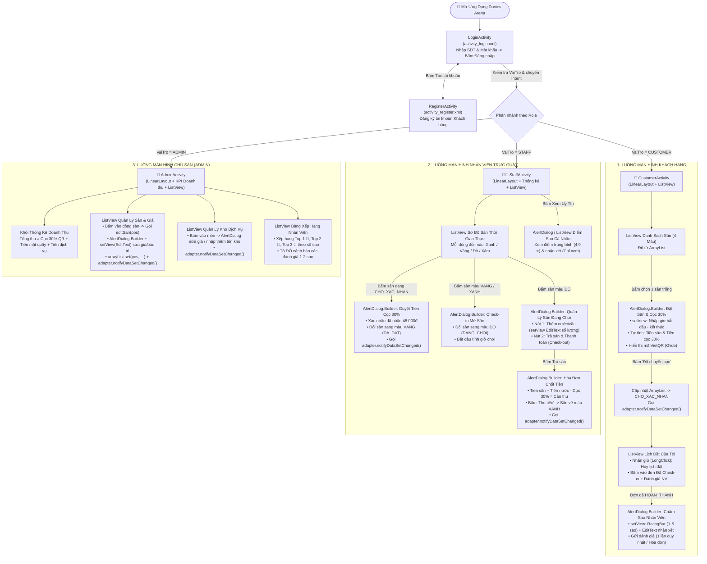
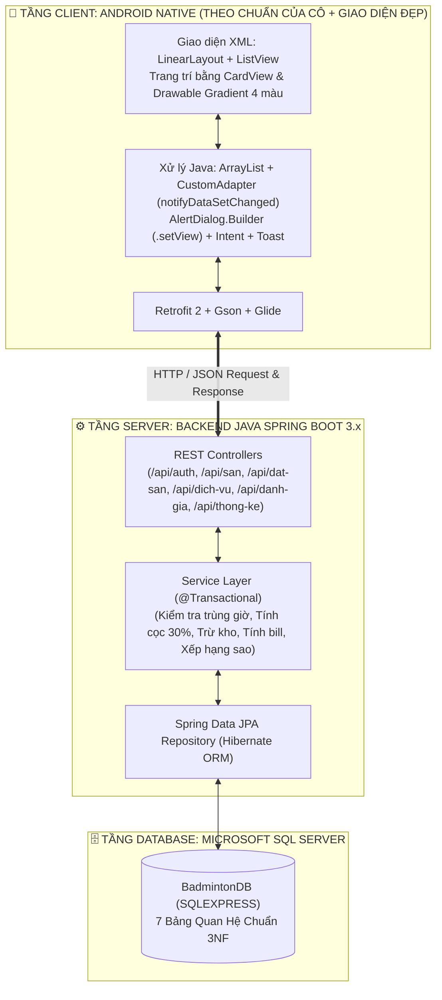

# BẢN KẾ HOẠCH DỰ ÁN HOÀN CHỈNH: HỆ THỐNG QUẢN LÝ SÂN CẦU LÔNG (DAVIES ARENA)
### PHƯƠNG ÁN CHUẨN: ANDROID NATIVE (JAVA + XML CỦA CÔ + GIAO DIỆN HIỆN ĐẠI) + SPRING BOOT 3 + SQL SERVER
*Giữ 100% kiến thức trên lớp (`LinearLayout`, `ListView`, `ArrayList`, `AlertDialog.Builder`) kết hợp trang trí XML hiện đại chuẩn Tailwind/Material Design*

---

## MỤC LỤC
1. [Phần I: Định hướng Thiết kế (Kết hợp Chuẩn Của Cô + Giao diện Hiện đại)](#phần-i-định-hướng-thiết-kế-kết-hợp-chuẩn-của-cô--giao-diện-hiện-đại)
2. [Phần II: Bảng Danh mục Công nghệ Sử dụng (Tech Stack)](#phần-ii-bảng-danh-mục-công-nghệ-sử-dụng-tech-stack)
3. [Phần III: Sơ đồ Luồng Màn hình Ứng dụng Mobile (App Flow)](#phần-iii-sơ-đồ-luồng-màn-hình-ứng-dụng-mobile-app-flow)
4. [Phần IV: Đặc tả Chi tiết 14 Chức năng & Cơ chế Hoạt động Từng Role](#phần-iv-đặc-tả-chi-tiết-14-chức-năng--cơ-chế-hoạt-động-từng-role)
5. [Phần V: Ma trận Phân quyền Toàn diện (RBAC Matrix)](#phần-v-ma-trận-phân-quyền-toàn-diện-rbac-matrix)
6. [Phần VI: Kiến trúc Hệ thống 3 Lớp & Thiết kế CSDL (ERD 7 Bảng)](#phần-vi-kiến-trúc-hệ-thống-3-lớp--thiết-kế-csdl-erd-7-bảng)
7. [Phần VII: Danh sách RESTful API Endpoints (Spring Boot)](#phần-vii-danh-sách-restful-api-endpoints-spring-boot)
8. [Phần VIII: Danh mục Giao diện XML, Drawable & Cấu trúc Project](#phần-viii-danh-mục-giao-diện-xml-drawable--cấu-trúc-project)
9. [Phần IX: Mẫu Code Chuẩn Phong Cách Của Cô Áp Dụng Vào Đồ Án](#phần-ix-mẫu-code-chuẩn-phong-cách-của-cô-áp-dụng-vào-đồ-án)
10. [Phần X: Lộ trình Thực hiện 6 Giai đoạn (Milestones)](#phần-x-lộ-trình-thực-hiện-6-giai-đoạn-milestones)

---

## PHẦN I: ĐỊNH HƯỚNG THIẾT KẾ (KẾT HỢP CHUẨN CỦA CÔ + GIAO DIỆN HIỆN ĐẠI)

Dự án được xây dựng theo **Cách 2: Thuần Android Native (Java + XML) theo sát giáo trình của cô giảng dạy trên lớp, nhưng được "Make-up" bằng hệ thống Drawable Gradient & CardView hiện đại như giao diện Davies Arena**:

1. **Giữ nguyên 100% kỹ thuật cốt lõi cô dạy trên lớp:**
   * Bố cục màn hình bằng **`LinearLayout`** (`orientation="vertical"` và `"horizontal"`).
   * Hiển thị mọi danh sách (Sân cầu lông, Kho dịch vụ, Lịch đặt sân, Bảng xếp hạng nhân viên) bằng **`ListView`** + **`ArrayList`** + **`Adapter`** và cập nhật giao diện tức thì bằng lệnh **`adapter.notifyDataSetChanged()`**.
   * Mọi thao tác Thêm / Sửa / Đặt cọc 30% / Check-in / Check-out / Chấm sao nhân viên đều sử dụng **`AlertDialog.Builder`** kết hợp khởi tạo `EditText`, `RatingBar` bằng Java và gắn qua lệnh **`.setView(...)`**.
   * Điều hướng màn hình bằng **`Intent`**, truyền dữ liệu qua `Bundle` / `putExtra` / `registerForActivityResult` và thông báo bằng **`Toast.makeText(...)`**.
2. **Nâng cấp thẩm mỹ XML đẹp tương đương Tailwind CSS:**
   * Thay vì để `ListView` hiển thị chữ đen nền trắng thô sơ, mỗi dòng của `ListView` được thiết kế bằng **`Custom Adapter`** kết hợp **`CardView` bo góc tròn (`18dp`)**, đổ bóng nổi và **4 bộ màu Gradient chuyển sắc** (`Xanh Ngọc` – `Vàng Cam` – `Đỏ San Hô` – `Xám Bạc`).

---

## PHẦN II: BẢNG DANH MỤC CÔNG NGHỆ SỬ DỤNG (TECH STACK)

| Tầng hệ thống | Công nghệ / Thành phần | Vai trò chi tiết trong dự án | Nguồn gốc kỹ thuật |
| :--- | :--- | :--- | :--- |
| **1. Mobile App (Frontend)** | **Java 17 (Android Native)** | Ngôn ngữ lập trình xử lý logic các `Activity`, `Adapter`, `Model` và sự kiện `OnClickListener` | *Nền tảng của cô* |
| | **XML Layout (`LinearLayout`)** | Thiết kế bố cục các màn hình chính phân chia theo khối dọc/ngang rõ ràng | *Nền tảng của cô* |
| | **`ListView` & `ArrayList`** | Hiển thị danh sách sân, đơn cọc, dịch vụ kho và bảng xếp hạng nhân viên | *Nền tảng của cô* |
| | **`Custom Adapter` (`BaseAdapter` / `ArrayAdapter`)** | Đổ dữ liệu từ `ArrayList` lên `ListView`, tự động đổi màu dòng sân và gọi `adapter.notifyDataSetChanged()` | *Mở rộng từ bài của cô* |
| | **`AlertDialog.Builder` + `.setView()`** | Tạo hộp thoại tương tác (Sửa giá sân, Đặt cọc 30%, Thêm nước, Xuất bill, Chấm sao nhân viên) | *Nền tảng của cô* |
| | **`Intent`, `Bundle`, `Toast`** | Chuyển màn hình giữa các Role, truyền dữ liệu và hiển thị thông báo | *Nền tảng của cô* |
| | **XML Drawable `<shape>` & `<gradient>`** | Tạo hiệu ứng chuyển màu Emerald/Teal, bo tròn nút bấm (`99dp`), bo góc thẻ sân (`18dp`) đẹp như CSS | *Làm đẹp giao diện XML* |
| | **`CardView`, `RatingBar`, `Chronometer`** | Đổ bóng thẻ sân, chọn 1–5 sao đánh giá nhân viên và đếm giờ chơi thực tế | *Android SDK / Material* |
| | **Retrofit 2, OkHttp 3 & Gson** | Giao tiếp HTTP RESTful API với Backend Spring Boot, chuyển đổi JSON tự động | *Kết nối Client-Server* |
| | **Glide** | Tải và hiển thị ảnh mã QR ngân hàng VietQR tự động điền số tiền cọc 30% | *Hiển thị mã QR* |
| | **SharedPreferences** | Lưu phiên đăng nhập cục bộ (`maNguoiDung`, `hoTen`, `vaiTro`, `token`) | *Android SDK* |
| **2. Backend (Server)** | **Java Spring Boot 3.x** | Xây dựng RESTful API tập trung, tính toán tiền cọc 30%, trừ tồn kho, xếp hạng sao | *Chuẩn Backend* |
| | **Spring Data JPA (Hibernate)** | Ánh xạ 7 bảng CSDL thành các lớp Entity, quản lý giao dịch `@Transactional` | *ORM Framework* |
| | **Spring Security + JWT & BCrypt** | Mã hóa mật khẩu và bảo mật phân quyền API cho 3 Role | *Bảo mật hệ thống* |
| | **Microsoft JDBC Driver & Lombok** | Kết nối SQL Server và tối giản code Getter/Setter | *Thư viện Backend* |
| **3. Cơ sở dữ liệu** | **Microsoft SQL Server (`SQLEXPRESS`)** | Lưu trữ tập trung 7 bảng quan hệ chuẩn 3NF, chống trùng lịch đặt sân | *Hệ quản trị CSDL* |
| **4. Công cụ (Tools)** | **Android Studio, IntelliJ IDEA, SSMS, Postman** | Bộ công cụ lập trình Android, lập trình Server, quản trị DB và test API | *Công cụ thực hành* |

---

## PHẦN III: SƠ ĐỒ LUỒNG MÀN HÌNH ỨNG DỤNG MOBILE (APP FLOW)



---

## PHẦN IV: ĐẶC TẢ CHI TIẾT 14 CHỨC NĂNG & CƠ CHẾ HOẠT ĐỘNG TỪNG ROLE

### 🏸 ROLE 1: KHÁCH HÀNG (CUSTOMER)

1. **Đăng ký & Đăng nhập (`LoginActivity` & `RegisterActivity`):**
   * Khách nhập SĐT và Mật khẩu vào `EditText`, bấm `Button` Đăng nhập.
   * Kiểm tra `if (user.isEmpty() || pass.isEmpty())` hiện `Toast` nhắc nhở. Nếu hợp lệ, gọi API xác thực và dùng `Intent` chuyển sang màn hình tương ứng.
2. **Xem danh sách sân & trạng thái màu trên `ListView`:**
   * Dữ liệu các sân (`Sân 1`, `Sân 2`...) được lưu trong `ArrayList<SanCauLong>` và hiển thị lên `ListView` qua `SanAdapter`.
   * Mỗi dòng sân trên `ListView` là một thẻ bo góc hiển thị rõ màu sắc: 🟢 Xanh (Trống), 🟡 Vàng (Đã cọc 30%), 🔴 Đỏ (Đang chơi), ⚪ Xám (Bảo trì).
3. **Đặt sân & Đặt cọc 30% bằng `AlertDialog.Builder`:**
   * Khi khách bấm vào 1 dòng sân đang **Trống** trên `ListView` (`listViewSan.setOnItemClickListener`), ứng dụng mở `AlertDialog.Builder`:
   * Bên trong Dialog gắn `LinearLayout` chứa ô chọn khung giờ (VD: `18:00 - 20:00 = 2 giờ`), tự động tính:
     * $\text{Tiền sân tạm tính} = 2 \times 80.000 = 160.000\text{đ}$
     * $\text{Tiền cọc bắt buộc (30\%)} = 48.000\text{đ}$
   * Hiển thị ảnh mã QR ngân hàng (bằng `Glide`) kèm nội dung chuyển khoản `COC SAN 1 0901234567`.
   * Khách bấm nút `.setPositiveButton("Tôi đã chuyển cọc", ...)` $\rightarrow$ Thêm đơn vào `arrayListLichDat`, cập nhật trạng thái và gọi `adapter.notifyDataSetChanged()`.
4. **Xem lịch đặt & Hủy lịch đặt sân:**
   * Hiển thị trên `ListView` lịch đặt của khách (kèm số tiền đã cọc 30% và số tiền còn lại trả tại sân).
   * Khách nhấn giữ (`setOnItemLongClickListener`) hoặc bấm vào đơn để mở `AlertDialog` xác nhận **Hủy lịch** (Hủy trước $\ge 2$ tiếng được hoàn cọc; hủy muộn $< 2$ tiếng mất cọc 30%).
5. **Chấm sao & Đánh giá nhân viên bằng `AlertDialog.Builder`:**
   * Khi đơn đặt sân đã chuyển sang trạng thái `HOAN_THANH` (đã thanh toán tại quầy), khách bấm vào đơn đó trên `ListView`.
   * Mở `AlertDialog.Builder` có gắn `RatingBar` (chấm 1–5 sao) và `EditText` (nhập nhận xét) qua lệnh `.setView(layout)` $\rightarrow$ Bấm `"Gửi đánh giá"` $\rightarrow$ Lưu điểm sao cho nhân viên thu ngân ca đó (mỗi hóa đơn chỉ chấm được 1 lần).

---

### 👨‍💼 ROLE 2: NHÂN VIÊN TRỰC QUẦY (STAFF)

6. **Theo dõi Sơ đồ sân 4 màu & Bộ đếm thống kê:**
   * Phía trên màn hình có 4 ô `TextView` đếm tự động số lượng sân: **Trống (Xanh) | Đã cọc (Vàng) | Đang chơi (Đỏ) | Bảo trì (Xám)**.
   * Phía dưới là `ListView` hiển thị toàn bộ danh sách sân thời gian thực.
7. **Duyệt tiền cọc 30% của khách:**
   * Nhân viên bấm vào đơn đang chờ xác nhận cọc trên `ListView` $\rightarrow$ Mở `AlertDialog.Builder` hiển thị thông tin: *"Khách Minh Khang - Sân 1 (18h-20h) - Tiền cọc 30%: 48.000đ"*.
   * Nhân viên kiểm tra tài khoản đã nhận tiền $\rightarrow$ Bấm `.setPositiveButton("Xác nhận đã nhận cọc", ...)` $\rightarrow$ Đổi trạng thái sân trong `ArrayList` sang `DA_DAT` (Màu Vàng) và gọi `adapter.notifyDataSetChanged()`.
8. **Check-in mở sân tính giờ thực tế:**
   * Khi khách đến sân, nhân viên bấm vào dòng sân màu Vàng (hoặc màu Xanh nếu khách vãng lai) trên `ListView` $\rightarrow$ Mở `AlertDialog.Builder` bấm **"Check-in Mở sân"**.
   * Sân chuyển sang trạng thái `DANG_CHOI` (Màu Đỏ), bắt đầu tính giờ thực tế và gọi `adapter.notifyDataSetChanged()`.
9. **Thêm nước uống, cầu lông, vợt vào bill (Tự động trừ kho):**
   * Khi khách đang chơi gọi thêm nước/cầu, nhân viên bấm vào dòng sân màu Đỏ $\rightarrow$ Mở `AlertDialog.Builder` gắn `Spinner` (chọn Nước suối, Revive, Cầu lông, Vợt) và `EditText` (nhập số lượng).
   * Bấm `"Thêm"` $\rightarrow$ Kiểm tra nếu không rỗng và đủ tồn kho thì cộng tiền dịch vụ vào sân đó, trừ số lượng tồn kho trong `arrayListDichVu`, gọi `adapter.notifyDataSetChanged()` và hiện `Toast` báo thành công.
10. **Check-out trả sân, khấu trừ cọc 30% & Thu tiền:**
    * Khi khách nghỉ chơi, nhân viên bấm trả sân $\rightarrow$ Mở `AlertDialog.Builder` hiển thị chi tiết hóa đơn:
      $$\text{Tổng thu thêm} = \text{Tiền sân thực tế} + \text{Tiền dịch vụ} - \text{Tiền cọc 30\% đã đóng}$$
    * Nhân viên bấm `.setPositiveButton("Hoàn tất thu tiền", ...)` $\rightarrow$ Lưu mã nhân viên thu ngân vào hóa đơn, đổi sân về màu **Xanh lá (`TRONG`)**, gọi `adapter.notifyDataSetChanged()` và mở khóa chức năng đánh giá sao cho khách.
11. **Xem Điểm Uy tín & Phản hồi Cá nhân:**
    * Nhân viên xem điểm trung bình sao của bản thân (VD: `4.9 / 5.0 ⭐`) và danh sách nhận xét của khách hàng trên `ListView` (chế độ chỉ xem, không được sửa/xóa).

---

### 👑 ROLE 3: CHỦ SÂN / QUẢN TRỊ VIÊN (ADMIN)

12. **Quản lý Sân & Giá thuê (Áp dụng đúng mẫu `editData` của cô):**
    * Hiển thị danh sách sân trên `ListView`. Có nút `"Thêm sân mới"` ở trên.
    * Khi bấm vào dòng sân thứ `pos` trên `ListView`, gọi hàm `editSan(int pos)`:
      * Khởi tạo `EditText` chứa giá thuê hiện tại, gắn vào `AlertDialog.Builder` bằng `.setView(editText)`.
      * Bấm `"Sửa"` $\rightarrow$ Kiểm tra `if (newValue.isEmpty())` báo `Toast`, nếu hợp lệ thì gọi `arrayListSan.set(pos, updatedSan)` và **`adapter.notifyDataSetChanged()`**.
      * Có nút chuyển nhanh trạng thái sân sang **Bảo trì (`BAO_TRI` – Màu Xám)**.
13. **Quản lý Kho Hàng & Dịch vụ (Nước uống, Cầu lông, Vợt):**
    * Hiển thị danh sách mặt hàng và số lượng tồn kho trên `ListView`.
    * Bấm vào mặt hàng thứ `pos` $\rightarrow$ Mở `AlertDialog.Builder` có `EditText` để sửa đơn giá hoặc nhập thêm số lượng hàng mới vào kho $\rightarrow$ `arrayListKho.set(pos, ...)` + `adapter.notifyDataSetChanged()`.
14. **Báo cáo Doanh thu & Bảng xếp hạng Nhân viên (Staff Leaderboard):**
    * Thẻ tổng hợp doanh thu trên cùng: Hiển thị rõ **Tổng doanh thu**, **Tiền cọc 30% qua QR**, **Tiền mặt tại quầy**, **Tiền bán nước/phụ kiện**.
    * `ListView` **Bảng xếp hạng nhân viên:** Sắp xếp nhân viên từ cao xuống thấp theo số sao trung bình (🥇 Hạng 1, 🥈 Hạng 2, 🥉 Hạng 3).
    * `ListView` **Lịch sử đánh giá:** Các đánh giá **1–2 sao** tự động đổi nền/viền sang màu **ĐỎ** cảnh báo để chủ sân xử lý khiếu nại ngay.

---

## PHẦN V: MA TRẬN PHÂN QUYỀN TOÀN DIỆN (RBAC MATRIX)

| STT | Chức năng hệ thống | Khách hàng (Customer) | Nhân viên (Staff) | Chủ sân (Admin) |
| :-: | :--- | :---: | :---: | :---: |
| 1 | Đăng ký / Đăng nhập tài khoản | ✅ Có | ✅ Có | ✅ Có |
| 2 | Xem danh sách sân (4 màu) & bảng giá | ✅ Có | ✅ Có | ✅ Có |
| 3 | Đặt sân & Chuyển khoản cọc 30% qua VietQR | ✅ Có | ✅ Có (Đặt hộ) | ✅ Có |
| 4 | Xác nhận đã nhận tiền cọc 30% (Đổi sân màu Vàng) | ❌ Không | ✅ Có | ✅ Có |
| 5 | Check-in mở sân tính giờ (Đổi sân màu Đỏ) | ❌ Không | ✅ Có | ✅ Có |
| 6 | Thêm nước uống, cầu lông vào bill & tự trừ kho | ❌ Không | ✅ Có | ✅ Có |
| 7 | Check-out chốt bill, khấu trừ cọc 30% & thu tiền | ❌ Không | ✅ Có | ✅ Có |
| 8 | Chấm điểm (1–5 sao) & nhận xét nhân viên trực ca | ✅ **Có (Sau thanh toán)** | ❌ Không | ❌ Không |
| 9 | Xem điểm đánh giá sao của bản thân | ❌ Không | ✅ **Có (Chỉ cá nhân)** | ✅ Có |
| 10 | Xem Bảng xếp hạng sao toàn bộ nhân viên | ❌ Không | ❌ Không | ✅ **Có (Leaderboard)** |
| 11 | Cảnh báo đỏ các đánh giá xấu (1–2 sao) | ❌ Không | ❌ Không | ✅ Có |
| 12 | Thêm / Sửa giá sân / Bật chế độ bảo trì sân | ❌ Không | ❌ Không | ✅ Có |
| 13 | Quản lý giá dịch vụ & Nhập thêm hàng tồn kho | ❌ Không | ❌ Không | ✅ Có |
| 14 | Xem Báo cáo Tổng Doanh thu & Tiền cọc / Tiền quầy | ❌ Không | ❌ Không | ✅ Có |

---

## PHẦN VI: KIẾN TRÚC HỆ THỐNG 3 LỚP & THIẾT KẾ CSDL (ERD 7 BẢNG)

### 1. Sơ đồ Kiến trúc 3 Lớp (3-Tier Architecture)



### 2. Sơ đồ Thực thể Quan hệ CSDL (ERD - 7 Bảng)
Hệ thống CSDL gồm 7 bảng chuẩn 3NF:
1. **`NGUOI_DUNG`**: `MaNguoiDung` (PK), `HoTen`, `SoDienThoai` (Unique), `MatKhau`, `VaiTro` (`CUSTOMER` / `STAFF` / `ADMIN`).
2. **`SAN_CAU_LONG`**: `MaSan` (PK), `TenSan`, `GiaMoiGio`, `TrangThai` (`TRONG` / `DA_DAT` / `DANG_CHOI` / `BAO_TRI`).
3. **`DAT_SAN`**: `MaDatSan` (PK), `MaSan` (FK), `MaNguoiDung` (FK), `ThoiGianBatDau`, `ThoiGianKetThuc`, `TienSanTamTinh`, `TienCoc30PhanTram`, `TrangThaiCoc`, `TrangThaiDatSan`.
4. **`DICH_VU`**: `MaDV` (PK), `TenDV`, `DonGia`, `DonViTinh`, `SoLuongTon`.
5. **`CHI_TIET_DICH_VU`**: `MaChiTiet` (PK), `MaDatSan` (FK), `MaDV` (FK), `SoLuong`, `DonGia`.
6. **`HOA_DON`**: `MaHD` (PK), `MaDatSan` (FK Unique), `TienSanThucTe`, `TienDichVu`, `TienCocDaTru`, `TongThanhToan`, `ThoiGianLap`, `NhanVienThu` (FK).
7. **`DANH_GIA_NHAN_VIEN`**: `MaDanhGia` (PK), `MaHD` (FK Unique – 1 hóa đơn chỉ chấm 1 lần), `MaKhachHang` (FK), `MaNhanVien` (FK), `SoSao` (1–5), `NoiDung`, `ThoiGianDanhGia`.

---

## PHẦN VII: DANH SÁCH RESTful API ENDPOINTS (SPRING BOOT)

* `POST /api/auth/register` & `POST /api/auth/login`: Đăng ký, đăng nhập trả về Role.
* `GET /api/san`, `POST /api/san`, `PUT /api/san/{id}`: Lấy danh sách sân, thêm sân, sửa giá/bảo trì sân.
* `POST /api/dat-san/tao-lich-coc`: Tạo đơn đặt sân kèm tiền cọc 30% (`CHO_XAC_NHAN`).
* `PUT /api/dat-san/{id}/xac-nhan-coc`: Nhân viên duyệt cọc $\rightarrow$ Sân đổi sang `DA_DAT` (Màu Vàng).
* `POST /api/dat-san/{id}/check-in`: Mở sân tính giờ $\rightarrow$ Sân đổi sang `DANG_CHOI` (Màu Đỏ).
* `POST /api/dat-san/{id}/them-dich-vu`: Gọi thêm nước/cầu vào bill và trừ `SoLuongTon`.
* `POST /api/dat-san/{id}/check-out`: Xuất hóa đơn, khấu trừ cọc 30%, trả sân về `TRONG` (Màu Xanh).
* `POST /api/danh-gia`, `GET /api/danh-gia/bang-xep-hang`: Gửi đánh giá sao và lấy bảng xếp hạng nhân viên.
* `GET /api/dich-vu`, `PUT /api/dich-vu/{id}`: Quản lý menu dịch vụ và nhập thêm tồn kho.
* `GET /api/thong-ke/doanh-thu`: Thống kê tổng doanh thu, tiền cọc QR và tiền mặt tại quầy.

---

## PHẦN VIII: DANH MỤC GIAO DIỆN XML, DRAWABLE & CẤU TRÚC PROJECT

### 1. Danh sách File Layout XML (`res/layout/`) – *Chuẩn `LinearLayout` + `ListView`*
1. `activity_login.xml`: `LinearLayout` dọc chứa `EditText` SĐT, Mật khẩu, `Button` Đăng nhập & Đăng ký.
2. `activity_register.xml`: `LinearLayout` dọc chứa `EditText` Họ tên, SĐT, Mật khẩu, `Button` Tạo tài khoản.
3. `activity_davies_arena.xml`: Màn hình chính tích hợp thanh chuyển Role (`Khách` | `Quầy` | `Chủ sân`), khối thống kê và các `ListView` hiển thị dữ liệu.
4. `item_san_listview.xml`: Giao diện cho **1 dòng trên `ListView` Sân** (dùng `CardView` bo góc + nền Gradient đổi theo 4 màu trạng thái + `TextView` Tên sân, Giá/giờ, Nhãn trạng thái).
5. `item_lich_dat_listview.xml`: Giao diện cho **1 dòng trên `ListView` Lịch đặt/Đơn cọc** (hiển thị Sân, Giờ chơi, Tiền cọc 30%, Nút bấm).
6. `item_xep_hang_listview.xml`: Giao diện cho **1 dòng trên `ListView` Bảng xếp hạng & Kho dịch vụ**.

### 2. Danh sách File Trang trí Drawable (`res/drawable/`) – *Làm đẹp XML như Tailwind CSS*
* `bg_header_gradient.xml`: Nền Header chuyển sắc Xanh Ngọc Lục Bảo (`#14B8A6` $\rightarrow$ `#047857`) bo cong đáy `28dp`.
* `bg_court_free.xml`: Gradient Xanh lá (`#34D399` $\rightarrow$ `#059669`) bo góc `18dp` cho sân Trống.
* `bg_court_booked.xml`: Gradient Vàng cam (`#FBBF24` $\rightarrow$ `#D97706`) bo góc `18dp` cho sân Đã cọc 30%.
* `bg_court_playing.xml`: Gradient Đỏ hồng (`#F87171` $\rightarrow$ `#DC2626`) bo góc `18dp` cho sân Đang chơi.
* `bg_court_maint.xml`: Gradient Xám bạc (`#BCC2CB` $\rightarrow$ `#808895`) bo góc `18dp` cho sân Bảo trì.
* `bg_button_gradient.xml` & `bg_card_white.xml`: Nút bấm bo tròn `99dp` và khung thẻ trắng bo góc `20dp`.

---

## PHẦN IX: MẪU CODE CHUẨN PHONG CÁCH CỦA CÔ ÁP DỤNG VÀO ĐỒ ÁN

Dưới đây là minh họa cách viết hàm **Sửa giá sân / Đổi trạng thái sân** và **Chấm sao nhân viên** trong dự án của chúng ta — **giữ đúng 100% cấu trúc hàm `editData` của cô**:

```java
// 1. Hàm sửa giá sân trên ListView (Giống hệt cấu trúc editData của cô)
private void editGiaSan(final int pos) {
    SanCauLong san = arrayListSan.get(pos);
    
    final EditText editText = new EditText(this);
    editText.setText(String.valueOf(san.getGiaMoiGio()));

    new AlertDialog.Builder(this)
            .setTitle("Sửa giá " + san.getTenSan())
            .setMessage("Nhập đơn giá thuê 1 giờ mới (VNĐ):")
            .setView(editText)
            .setPositiveButton("Sửa", new DialogInterface.OnClickListener() {
                @Override
                public void onClick(DialogInterface dialogInterface, int which) {
                    String newValue = editText.getText().toString().trim();
                    if (newValue.isEmpty()) {
                        Toast.makeText(DaviesArenaActivity.this, "Không được để trống!", Toast.LENGTH_SHORT).show();
                    } else {
                        san.setGiaMoiGio(Integer.parseInt(newValue));
                        arrayListSan.set(pos, san);
                        sanAdapter.notifyDataSetChanged(); // Tự động vẽ lại ListView
                        Toast.makeText(DaviesArenaActivity.this, "Cập nhật giá sân thành công!", Toast.LENGTH_SHORT).show();
                    }
                }
            })
            .setNegativeButton("Hủy", null)
            .show();
}
```

---

## PHẦN X: LỘ TRÌNH THỰC HIỆN 6 GIAI ĐOẠN (MILESTONES)

1. **Giai đoạn 1 (Database SQL Server):** Tạo 7 bảng chuẩn 3NF trên `SQLEXPRESS` và thêm dữ liệu mẫu (3 tài khoản Role, 6 sân cầu lông, 4 mặt hàng dịch vụ).
2. **Giai đoạn 2 (Backend Spring Boot):** Xây dựng các Entity, Repository, Service và REST Controller cho luồng Đặt cọc 30%, Check-in, Trừ kho, Check-out và Đánh giá sao.
3. **Giai đoạn 3 (Giao diện XML + Drawable đẹp):** Thiết kế các file `LinearLayout` + `ListView` kết hợp bộ Drawable Gradient 4 màu chuẩn Davies Arena.
4. **Giai đoạn 4 (Code Java theo chuẩn của cô):** Viết `ArrayList`, `Custom Adapter` (`notifyDataSetChanged()`), và các hộp thoại `AlertDialog.Builder` (`.setView()`) cho cả 3 Role.
5. **Giai đoạn 5 (Ghép nối & Chạy máy ảo):** Kết nối API và kiểm thử toàn bộ luồng liên hoàn 3 Role trên máy ảo Android Studio.
6. **Giai đoạn 6 (Hoàn thiện Báo cáo & Vấn đáp):** Chụp ảnh màn hình thực tế đưa vào báo cáo Word và chuẩn bị câu trả lời bảo vệ.
